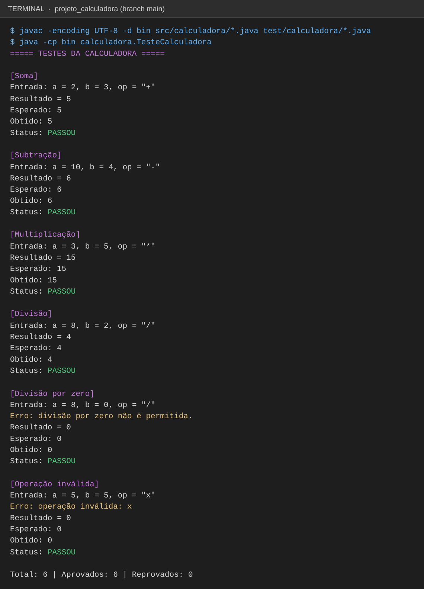
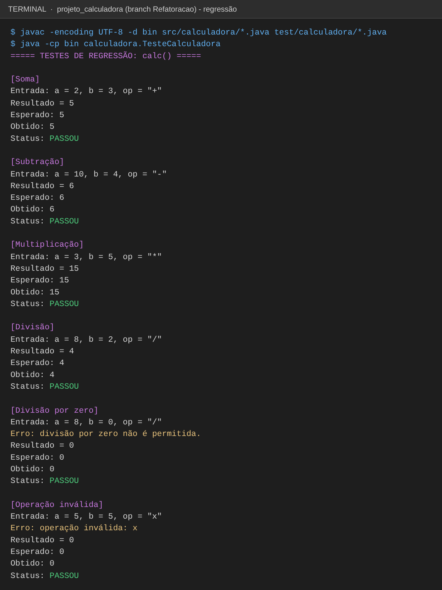
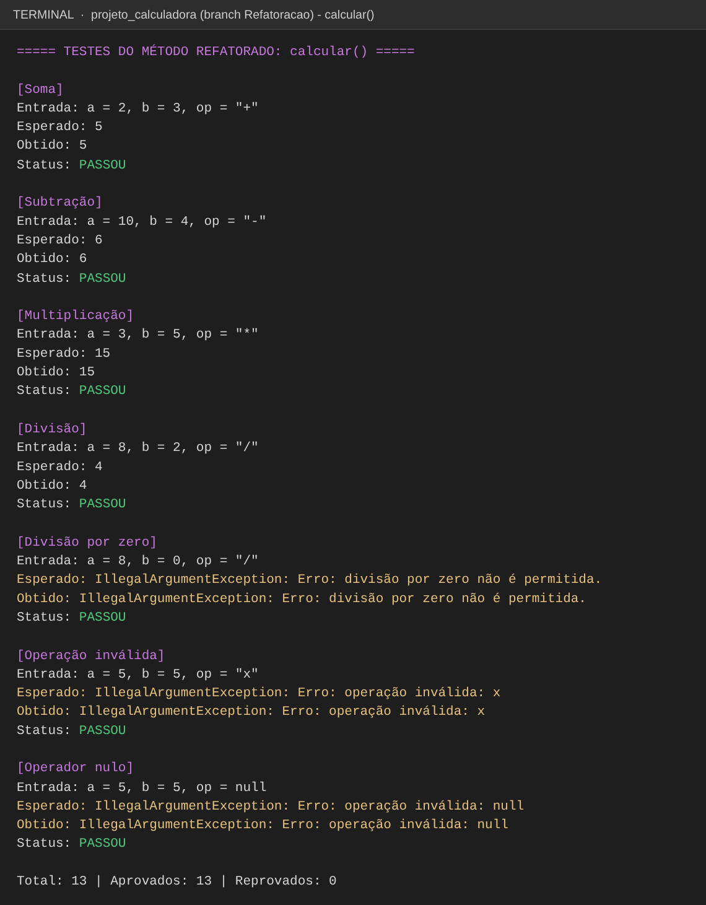
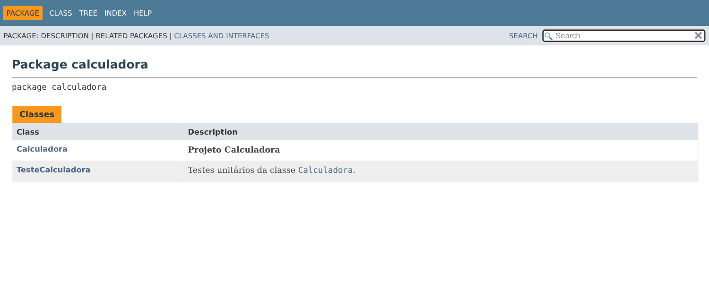
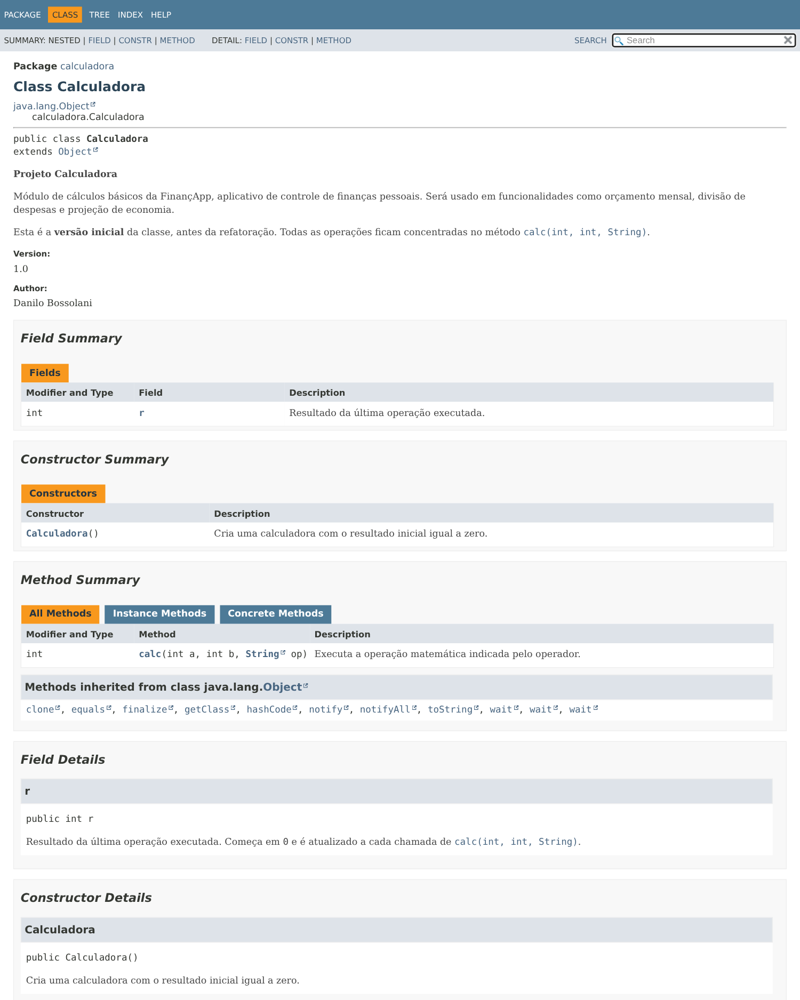
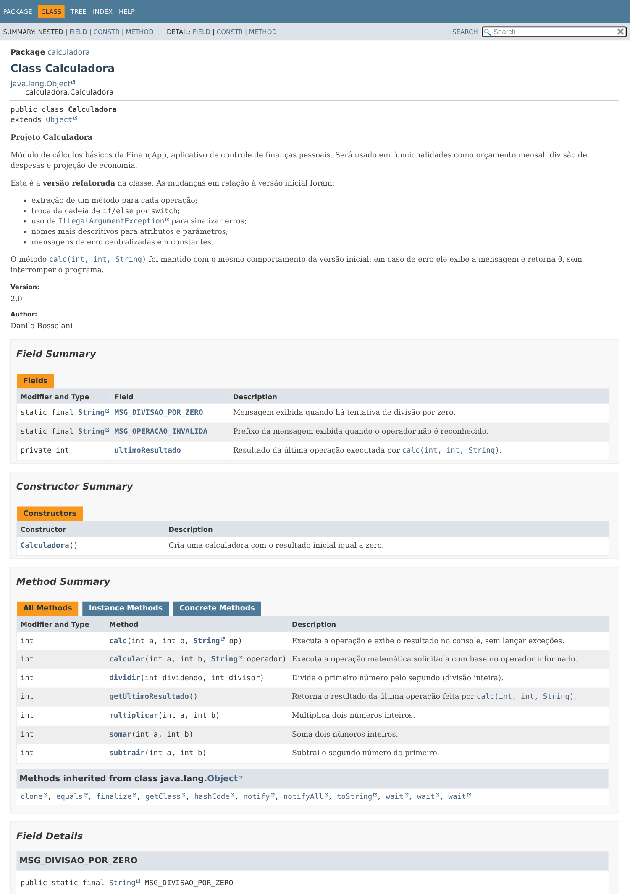
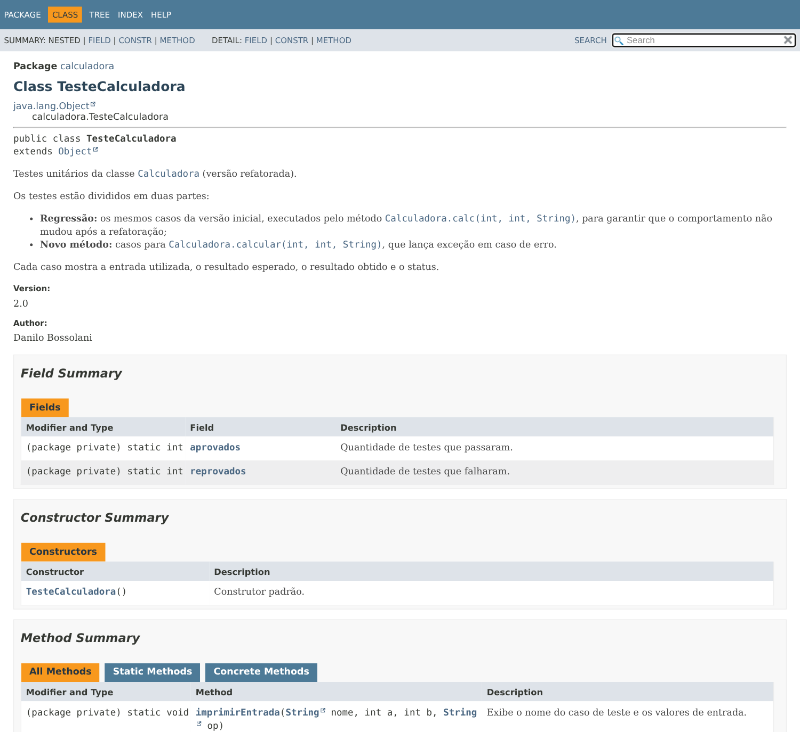
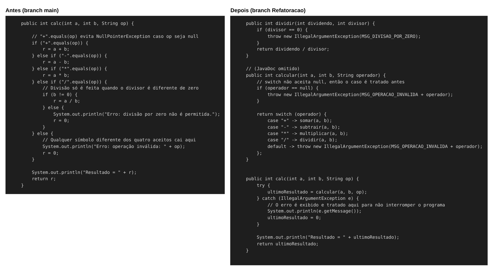

# Projeto Calculadora — FinançApp

> Projeto acadêmico desenvolvido com foco em Qualidade de Software, Testes, Refatoração, Documentação e Versionamento.

---

## 1. Identificação do Projeto

**Projeto:** Projeto Calculadora  
**Contexto:** FinançApp  
**Aluno:** Danilo Bossolani  
**RA:** 250902  
**Curso:** Análise e Desenvolvimento de Sistemas — FACENS  
**Disciplina:** UX/UI e Testes de Software  
**Professor:** Daniel Ohata  
**Semestre:** 2026.2  

---

# 2. Visão Geral

O projeto consiste no desenvolvimento de um módulo de cálculos matemáticos básicos em Java para a startup fictícia **FinançApp**.

O módulo foi desenvolvido com o objetivo de ser utilizado futuramente em funcionalidades de controle financeiro, como:

- orçamento mensal;
- divisão de despesas;
- projeções financeiras;
- cálculos auxiliares.

Além do funcionamento correto das operações, o projeto aplica práticas de qualidade de software relacionadas a:

- testes;
- tratamento de erros;
- refatoração;
- documentação;
- versionamento;
- manutenção de código.

---

# 3. Problema

Durante o desenvolvimento da aplicação FinançApp, foi identificada a necessidade de criar um módulo matemático reutilizável.

Entretanto, a equipe definiu que o módulo não deveria apenas funcionar corretamente, mas também apresentar:

- código legível;
- testes automatizados;
- tratamento de falhas;
- documentação técnica;
- controle de versões;
- facilidade de manutenção.

O desafio consiste, portanto, em desenvolver uma solução funcional e ao mesmo tempo aplicar boas práticas de Engenharia de Software.

---

# 4. Objetivo

## 4.1 Objetivo Geral

Desenvolver uma calculadora em Java aplicando práticas de qualidade, testes, documentação, refatoração e versionamento.

## 4.2 Objetivos Técnicos

- implementar operações matemáticas básicas;
- tratar entradas inválidas;
- impedir divisão por zero;
- desenvolver testes automatizados;
- refatorar o código sem alterar seu comportamento;
- documentar classes e métodos com JavaDoc;
- gerar documentação HTML;
- utilizar Git e GitHub;
- organizar commits e branches;
- manter documentação técnica no README.

---

# 5. Escopo Funcional

A aplicação deverá oferecer as seguintes operações:

| ID | Funcionalidade | Descrição | Status |
|---|---|---|---|
| RF01 | Soma | Soma dois números inteiros | ✅ |
| RF02 | Subtração | Subtrai dois números inteiros | ✅ |
| RF03 | Multiplicação | Multiplica dois números inteiros | ✅ |
| RF04 | Divisão | Divide dois números inteiros | ✅ |
| RF05 | Validação de divisão | Impede divisão por zero | ✅ |
| RF06 | Operação inválida | Trata operadores não suportados | ✅ |

---

# 6. Requisitos Não Funcionais

| ID | Categoria | Requisito |
|---|---|---|
| RNF01 | Qualidade | O código deve possuir organização e legibilidade |
| RNF02 | Testabilidade | As operações devem possuir testes automatizados |
| RNF03 | Manutenção | O código deve permitir refatoração sem alteração funcional |
| RNF04 | Documentação | Classes e métodos devem possuir JavaDoc |
| RNF05 | Versionamento | O projeto deve utilizar Git e GitHub |
| RNF06 | Confiabilidade | Erros não devem interromper inesperadamente a execução |

---

# 7. Tecnologias Utilizadas

| Tecnologia | Versão | Utilização |
|---|---|---|
| Java | 21 | Desenvolvimento |
| JDK (OpenJDK) | 21 | Compilação (`javac`) e execução (`java`) |
| Testes | — | Classe `TesteCalculadora` com método `main`, conforme modelo da aula |
| Git | 2.x | Controle de versão |
| GitHub | — | Repositório remoto |
| JavaDoc | 21 | Documentação HTML |
| IDE | VS Code | Ambiente de desenvolvimento |

---

# 8. Estrutura do Projeto

```text
projeto_calculadora/
│
├── src/
│   └── calculadora/
│       └── Calculadora.java
│
├── test/
│   └── calculadora/
│       └── TesteCalculadora.java
│
├── docs/
│   └── index.html
│
├── images/
│   ├── testes/
│   ├── javadoc/
│   └── refatoracao/
│
├── README.md
└── .gitignore
```

---

# 9. Operações

O método principal da classe `Calculadora` é `calc(int a, int b, String op)`. Após a refatoração, cada operação também passou a ter seu próprio método.

| Operador | Operação | Método | Exemplo | Resultado |
|---|---|---|---|---|
| `+` | Soma | `somar(a, b)` | `calc(2, 3, "+")` | `5` |
| `-` | Subtração | `subtrair(a, b)` | `calc(10, 4, "-")` | `6` |
| `*` | Multiplicação | `multiplicar(a, b)` | `calc(3, 5, "*")` | `15` |
| `/` | Divisão inteira | `dividir(dividendo, divisor)` | `calc(8, 2, "/")` | `4` |

Métodos de entrada:

| Método | Em caso de erro |
|---|---|
| `calc(a, b, op)` | Exibe a mensagem de erro, retorna `0` e o programa continua |
| `calcular(a, b, operador)` | Lança `IllegalArgumentException` com a mensagem de erro |

## 9.1 Tratamento de erros

| Situação | Exemplo | `calc` | `calcular` |
|---|---|---|---|
| Divisão por zero | `(8, 0, "/")` | Exibe `Erro: divisão por zero não é permitida.` e retorna `0` | `IllegalArgumentException` |
| Operador inválido | `(5, 5, "x")` | Exibe `Erro: operação inválida: x` e retorna `0` | `IllegalArgumentException` |
| Operador nulo | `(5, 5, null)` | Exibe `Erro: operação inválida: null` e retorna `0` | `IllegalArgumentException` |

Usando `calc`, o programa nunca é interrompido. A exceção lançada por `calcular` é capturada dentro de `calc`.

---

# 10. Como Executar

Na raiz do projeto:

```bash
# Compilar
javac -encoding UTF-8 -d bin src/calculadora/*.java test/calculadora/*.java

# Executar os testes
java -cp bin calculadora.TesteCalculadora
```

Para gerar a documentação JavaDoc na pasta `docs/`:

```bash
javadoc -private -author -version -encoding UTF-8 -docencoding UTF-8 -charset UTF-8 -d docs -sourcepath src:test calculadora
```

> No Windows, use `src;test` no lugar de `src:test`.

---

# 11. Testes

A classe `TesteCalculadora` mostra, para cada caso, a entrada utilizada, o resultado esperado, o resultado obtido e o status. Ao final, exibe o total de testes aprovados e reprovados.

## 11.1 Testes da versão inicial (branch `main`)

| Caso | Entrada | Esperado | Obtido | Status |
|---|---|---|---|---|
| Soma | `2, 3, "+"` | 5 | 5 | PASSOU |
| Subtração | `10, 4, "-"` | 6 | 6 | PASSOU |
| Multiplicação | `3, 5, "*"` | 15 | 15 | PASSOU |
| Divisão | `8, 2, "/"` | 4 | 4 | PASSOU |
| Divisão por zero | `8, 0, "/"` | 0 + mensagem de erro | 0 + mensagem de erro | PASSOU |
| Operação inválida | `5, 5, "x"` | 0 + mensagem de erro | 0 + mensagem de erro | PASSOU |



## 11.2 Testes após a refatoração (branch `Refatoracao`)

Depois da refatoração, todos os testes foram executados novamente. A classe de testes passou a ter duas partes:

1. **Regressão:** os mesmos seis casos da versão inicial, usando `calc()`, para confirmar que o comportamento não mudou.
2. **Método refatorado:** sete casos usando `calcular()`, incluindo a verificação das exceções e do operador nulo.

| Caso (`calcular`) | Entrada | Esperado | Status |
|---|---|---|---|
| Soma | `2, 3, "+"` | 5 | PASSOU |
| Subtração | `10, 4, "-"` | 6 | PASSOU |
| Multiplicação | `3, 5, "*"` | 15 | PASSOU |
| Divisão | `8, 2, "/"` | 4 | PASSOU |
| Divisão por zero | `8, 0, "/"` | `IllegalArgumentException` | PASSOU |
| Operação inválida | `5, 5, "x"` | `IllegalArgumentException` | PASSOU |
| Operador nulo | `5, 5, null` | `IllegalArgumentException` | PASSOU |

Resultado: **13 testes, 13 aprovados, 0 reprovados.**

### Regressão (`calc`)



### Método refatorado (`calcular`)



---

# 12. Documentação JavaDoc

A documentação foi gerada com a ferramenta `javadoc` e está na pasta [`docs/`](docs/). Para visualizar, abra o arquivo `docs/index.html` no navegador.

Foram documentados: classes, atributos, construtores, métodos, parâmetros, retornos e exceções, usando as tags `@author`, `@version`, `@param`, `@return` e `@throws`.

## 12.1 Página do pacote



## 12.2 Classe Calculadora — versão inicial



## 12.3 Classe Calculadora — versão refatorada



## 12.4 Classe TesteCalculadora — versão refatorada



---

# 13. Refatoração

A refatoração foi feita na branch `Refatoracao`, em commits separados, sem alterar o comportamento do método `calc`.

| Técnica | O que foi feito |
|---|---|
| Extração de métodos | Cada operação foi para um método próprio: `somar`, `subtrair`, `multiplicar` e `dividir` |
| Simplificação de condicionais | A cadeia de `if/else if` foi substituída por um `switch` no método `calcular` |
| Melhoria nos nomes | Atributo `r` passou a se chamar `ultimoResultado`; parâmetros de `dividir` passaram a ser `dividendo` e `divisor` |
| Encapsulamento | `ultimoResultado` passou de `public` para `private`, com o método `getUltimoResultado()` |
| Tratamento de erros | Erros passaram a ser sinalizados com `IllegalArgumentException`; `calc` captura a exceção e mantém o comportamento original |
| Organização lógica | Mensagens de erro centralizadas nas constantes `MSG_DIVISAO_POR_ZERO` e `MSG_OPERACAO_INVALIDA` |

## 13.1 Antes e depois



## 13.2 Commits da refatoração

```text
refactor: extrai metodos somar, subtrair, multiplicar e dividir e renomeia atributo r
refactor: substitui if/else por switch e trata erros com IllegalArgumentException
test: atualiza TesteCalculadora com regressao e testes do metodo calcular
docs: atualiza JavaDoc e regenera documentacao HTML da versao refatorada
```

Após cada etapa os testes foram executados novamente e todos continuaram passando.

---

# 14. Branches

| Branch | Conteúdo |
|---|---|
| `main` | Versão inicial da calculadora, com testes e documentação |
| `Refatoracao` | Versão refatorada do código, com os testes executados novamente |

---

# 15. Repositório

https://github.com/danilobossolani/projeto_calculadora
